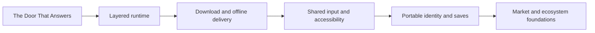

# Phase 1033 Omniland capability research

*Technical synthesis for the ScrollVerse local build; current factual capabilities are separated from design recommendations.*

---

## 📋 Executive summary

The strongest technically grounded path to a **console-less Omniland** is a responsive, browser-first product that works as an ordinary website and progressively enhances itself. The baseline should be semantic HTML/CSS/JavaScript with accessible controls, local-first saves, explicit download/import, and a compact app shell. Richer tiers can add WebAssembly, WebGL 1/2, and opportunistic WebGPU, while preserving a non-3D path when graphics APIs or hardware are unavailable. Web App Manifest and service workers can improve installability and offline behavior, but neither guarantees a store installation or external distribution.

The recommended order is deliberately user-first: **The Door That Answers** establishes a useful, text-capable entry point before adding runtime, delivery, input, identity, and market foundations. This sequence avoids making a GPU, gamepad, microphone, account, live service, payment provider, or app-store wrapper a prerequisite for the core experience. Nothing in this report claims external launch, live synchronization, provider activation, or market availability for ScrollVerse.

## 🎯 Scope and decision principles

This report answers: what should the local build add to support desktop, mobile, tablet, and assistive devices through download/import with low overhead?

The design should follow these principles:

- **Content before rendering:** navigation, metadata, controls, status, and important actions remain available through ordinary DOM interfaces.
- **Progressive enhancement:** capability detection selects richer rendering and input tiers; user-agent strings are not the decision mechanism.[^1][^5]
- **Portable ownership:** user-created or user-owned packages can be exported and imported without sign-in, special filesystem APIs, or a live service.
- **Recoverability:** renderer loss, storage eviction, malformed imports, denied permissions, and interrupted writes do not destroy the application state.
- **Explicit boundaries:** recommendations are implementation proposals, not statements that ScrollVerse has activated any external service or launched any public market.

## 🧭 Staged roadmap

The roadmap starts with the smallest useful doorway and then adds foundations in dependency order.

### Stage 1 — The Door That Answers

**Goal:** make the product useful before it is immersive.

**Recommended addition:** one HTTPS browser room with a semantic, text-first interface. Use WebSocket only for bounded text, presence, and signaling once the local experience is stable. Keep a text fallback for every voice or AI-assisted interaction. An AI citizen should be visibly labeled, constrained to a purpose and tool set, and able to escalate uncertainty. Moderation should combine rate limits and basic checks with AI risk triage and human approval for bans, sensitive responses, publication, or external side effects.[^21][^22][^23][^24][^25]

**Current factual capabilities:** WebRTC supports browser media and generic data channels but expects application-provided signaling; WebSocket supports bidirectional browser-server sessions but has no built-in backpressure; microphone access requires HTTPS and explicit permission. NIST recommends documented human-AI roles and oversight. The EU Digital Services Act is a governance reference for disclosed moderation, complaint handling, and human review where automation is used; applicability depends on service scope and jurisdiction.[^21][^22][^23][^24][^25]

**Acceptance criteria:**

- A first-time visitor can read the room, ask a text question, receive a bounded answer, and exit without an account or microphone permission.
- AI citizens are labeled; purpose, available actions, uncertainty escalation, and undo/reversal behavior are visible in the same flow.
- WebSocket message size, queue depth, heartbeat rate, and idle connection lifetime are bounded; typing and presence updates are coalesced.
- Join voice is an explicit action with visible permission, mute, leave, and report controls; media tracks stop on exit.
- A text-only fallback remains fully usable when WebRTC, microphone access, or live connectivity is unavailable.

### Stage 2 — Layered runtime

**Goal:** render more richly without making GPU support a requirement.

**Recommended addition:** use four runtime tiers: semantic HTML/DOM baseline; optional lazy-loaded Wasm for CPU-heavy parsing, indexing, compression, or simulation; WebGL 1/2 rendering; and opportunistic WebGPU. Keep application state outside the renderer and recreate resources after context or device loss.

**Current factual capabilities:** WebGPU requires secure-context access, adapter/device negotiation, and feature/limit checks; adapter acquisition can return `null`, and browser/platform coverage is uneven and version-sensitive. WebAssembly is a safe, portable, compact low-level format suitable for optional renderer-independent compute. WebGL is the practical broad graphics fallback, with hardware and per-device capability caveats; WebGL 2 maps to much of OpenGL ES 3.0. Progressive enhancement means essential content and controls work without GPU APIs.[^1][^2][^3][^4][^5]

**Acceptance criteria:**

- The core navigation and important actions work with JavaScript and canvas disabled or unavailable.
- Runtime negotiation checks `navigator.gpu`, handles null adapters and device-request failure, inspects required features/limits, and falls back through `webgl2`, `webgl`, and non-3D rendering.
- Wasm is lazy-loaded, has a bounded worker/memory budget, and has a JavaScript fallback.
- WebGL context loss and WebGPU device loss preserve app state and trigger resource recreation rather than a blank screen.
- Coverage tests include Chromium desktop and Android, Firefox Windows, Safari desktop/mobile, WebGL-only and restricted-GPU environments, assistive settings, and slow networks.

### Stage 3 — Download, import, and offline delivery

**Goal:** make Omniland portable and low-overhead without requiring an app store.

**Recommended addition:** ship one canonical HTTPS origin with a stable manifest, icons, `start_url`, scope, and standalone or minimal-UI display. Define a small versioned package format and make ordinary browser download plus `<input type="file">` import the baseline. Add service-worker caching for a small app shell and compact catalog, with explicit offline/read-only states. Treat Cache API, IndexedDB, and OPFS as replaceable workspace/cache layers, not the sole copy of user-owned content.[^6][^7][^8][^9][^10]

**Current factual capabilities:** a manifest supplies identity and launch metadata. Chromium install promotion currently expects HTTPS, required manifest fields, 192px and 512px icons, an accepted display mode, and no positive `prefer_related_applications`; engagement heuristics and other-browser behavior vary. Service workers provide install/activate/fetch lifecycle hooks and programmable offline behavior but are not the installability prerequisite. Browser storage is origin-scoped and normally best-effort. File System Access and OPFS are secure-context, capability- and permission-dependent enhancements.[^6][^7][^8][^9][^10][^15]

**Acceptance criteria:**

- The complete core product works as a normal website; installation is optional.
- A package contains a package ID, schema version, checksums, relative asset paths, rights/fallback metadata, and human-readable metadata.
- Import validates schema, size, checksum, compatibility, and replacement conflicts before applying changes.
- Cache versions are explicit; stale versions are removed on activation; quota/eviction and storage status are surfaced to users.
- Unsupported browsers or denied filesystem permissions fall back to ordinary download/upload.
- No acceptance criterion assumes a store listing, native wrapper, external deployment, provider activation, or live synchronization.

### Stage 4 — Shared input and accessibility

**Goal:** provide one command model across desktop, mobile, tablet, and assistive devices.

**Recommended addition:** map keyboard, Pointer Events, touch, and optional Gamepad input into the same action layer. Use semantic HTML overlays for menus, dialogs, settings, labels, status, and important actions. Make click/tap and keyboard primary; treat swipe, pinch, drag, and gamepad input as accelerators. Use 44×44 CSS pixel targets for primary controls where practical, with WCAG’s 24×24 CSS pixel rule as the conformance floor. Centralize reduced-motion behavior and pair `prefers-reduced-motion: reduce` with an in-app toggle.[^11][^12][^13][^14][^15]

**Current factual capabilities:** WCAG 2.2 requires keyboard-operable functionality and no keyboard traps; multipoint/path gestures need a single-pointer alternative, dragging needs a non-drag alternative, and target size has a 24×24 CSS pixel minimum subject to exceptions. Pointer Events cover mouse, pen, and touch. Gamepad is progressive enhancement through `navigator.getGamepads()`, connection events, buttons, and axes. Non-essential interaction-triggered motion should be disable-able, with reduced-motion media preferences available to the UI.[^11][^12][^13][^14][^15]

**Acceptance criteria:**

- Every primary action is reachable by keyboard, pointer/tap, and screen-reader-compatible semantic controls.
- No essential task requires a multipoint gesture, path gesture, dragging, hover, gamepad, microphone, or 3D rendering.
- Focus order is logical, focus is visible, dialogs have labeled names and escape paths, and status updates are announced appropriately.
- Primary touch targets are 44×44 CSS pixels where practical; automated and manual checks verify the 24×24 floor and spacing exceptions.
- Reduced-motion mode removes parallax, camera swoops, shake, and rapid zooms; the setting persists locally.
- Gamepad reconnect/disconnect does not block keyboard or pointer users.

### Stage 5 — Portable identity and saves

**Goal:** preserve progress across devices without making identity a prerequisite.

**Recommended addition:** use IndexedDB as the local-first canonical save store; maintain migrations for every save schema version; offer one-tap export/import before sign-in. Use an opaque local continuity ID by default. Offer optional WebAuthn/passkey linking only for users who choose cross-device sync. If an optional sync service is later implemented, encrypt payloads client-side, minimize metadata, and model immutable revisions with parent revision, logical clock, device/profile ID, and content hash.[^15][^16][^17][^18][^19]

**Current factual capabilities:** IndexedDB is an asynchronous, same-origin structured-data store with indexes and transactions. Browser storage can be evicted and quotas vary; persistent storage is an optional request. WebAuthn discoverable credentials are relying-party scoped and keep private keys in authenticators while the relying party verifies with a public key. Web Crypto exposes primitives for encryption, decryption, signing, verification, key generation, derivation, import/export, and wrapping in secure contexts; it does not define the application’s key lifecycle or conflict policy.[^15][^16][^17][^18][^19]

**Acceptance criteria:**

- Guest play works offline and creates a recoverable local save.
- Export and import work before sign-in and reject malformed, oversized, incompatible, or checksum-invalid packages without altering the current save.
- Divergent revisions are surfaced for user choice; no silent overwrite occurs.
- Tests cover eviction, quota exhaustion, private browsing, interrupted writes, malformed imports, stale revisions, lost credentials, clock skew, and offline reconnects.
- Any future sync prototype is explicitly opt-in and does not remove portable files as the recovery path.

### Stage 6 — Market and ecosystem foundations

**Goal:** create interoperable, observable, rights-aware building blocks without prematurely adding operational overhead.

**Recommended addition:** use versioned glTF/GLB as the 3D exchange and delivery boundary, with extension, size, texture, rights, and fallback metadata. Build a small creator kit from reusable web components rather than a heavyweight proprietary editor. Offer free browsing and limited creator publishing, or a short no-card trial with explicit conversion, pause/cancel, reminders, and pricing boundaries. Instrument install, asset, scene, creator, checkout, and latency events through an OpenTelemetry-compatible pipeline. Defer native wrappers and payment-provider activation until a concrete discovery or OS-integration need justifies their signing, review, policy, account, update, and operational cost.[^6][^20][^26][^27][^28]

**Current factual capabilities:** glTF 2.0 is an open, API-neutral runtime asset-delivery format for interoperable web/mobile use; it is not an authoring or streaming format and does not define runtime behavior. Web Components provide custom elements, Shadow DOM, templates, and lifecycle callbacks for reusable browser-native modules. OpenTelemetry is vendor-neutral instrumentation and collection, not a backend. Stripe Checkout supports configurable free trials, optional payment-method collection, and trial-end cancel/pause behavior, with a documented 730-day maximum; none of this activates Stripe for ScrollVerse.[^20][^26][^27][^28]

**Acceptance criteria:**

- Assets declare format/version, extension requirements, size/texture budgets, rights status, and fallback media.
- Creator components expose documented data/events, accessible defaults, and lifecycle cleanup.
- Pricing and trial behavior are testable in a local or explicitly isolated environment before any provider activation.
- Telemetry is privacy-minimized, names stable events, and supports latency/error diagnosis without requiring a particular vendor backend.
- Release gates include browser/device compatibility, accessibility, performance, provenance, payment lifecycle, observability, deep-link, and rollback checks.

## 📊 Priority comparison

| Priority | Foundation | User value | Overhead | Dependency | Recommendation |
| --- | --- | --- | --- | --- | --- |
| 1 | The Door That Answers | Immediate orientation and help | Low–medium | None | Build first |
| 2 | Layered runtime | Rich scenes on capable devices | Medium | Door content model | Build after baseline |
| 3 | Download/import delivery | Portable ownership and low-friction recovery | Low | Package schema | Build early, alongside runtime |
| 4 | Shared input/accessibility | Cross-device and assistive usability | Medium | Shared command model | Build before immersive expansion |
| 5 | Portable identity/saves | Continuity without mandatory accounts | Medium | Import/export and local store | Build after package contract |
| 6 | Market/ecosystem | Creator scale, interoperability, monetization | High | Provenance, telemetry, policy | Defer until foundations pass |

The key tradeoff is to spend complexity on **fallbacks and recovery**, not on a single high-end renderer or an early service integration. A WebGPU-only, app-store-first, account-first, or voice-first build would make more devices and users dependent on capabilities that the sources identify as conditional.

## ⚠️ Risks and mitigations

| Risk | Why it matters | Mitigation |
| --- | --- | --- |
| Uneven WebGPU/browser support | Adapter or device creation can fail; coverage is version-sensitive | Feature-detect, negotiate, fall back to WebGL and non-3D; maintain a coverage matrix[^1][^2] |
| GPU/context/device loss | A renderer can disappear during use | Keep state outside renderer; recreate resources and preserve the current route |
| Storage eviction or quota limits | Local data is not automatically durable | Exportable packages, storage status, migrations, checksums, optional persistence request[^9][^15] |
| Permission friction | Microphone and filesystem features require secure context and user consent | Permission only after explicit action; show state; retain text and upload/download paths[^10][^23] |
| Input exclusion | Gesture-only, hover-only, or gamepad-only flows block users | Shared action layer, semantic controls, keyboard path, non-drag alternatives[^11][^12][^13] |
| Motion sensitivity | Camera movement and effects can cause discomfort | Central reduced-motion mode and explicit toggle[^14] |
| WebSocket overload | WebSocket has no built-in backpressure | Bound queues/rates, coalesce updates, close idle connections[^22] |
| Identity lock-in or data loss | Credentials and origin-scoped saves are not portable by themselves | Guest-first export/import; optional WebAuthn; immutable revisions[^15][^17] |
| AI or moderation harm | Automated decisions can be opaque or irreversible | Label AI, constrain tools, human approval, appeals, audit events[^24][^25] |
| Premature market/provider coupling | Store, payment, and backend operations add policy and rollback burden | Defer wrappers/provider activation; test contracts locally and gate releases[^7][^28] |

## ✅ Release gate for the local build

Before calling the local capability slice complete, verify:

- [ ] The Door That Answers works in text-only mode with no account, microphone, GPU, or live connection.
- [ ] Semantic HTML controls and keyboard navigation remain usable when rich rendering is unavailable.
- [ ] Capability negotiation selects WebGPU, WebGL 2/1, or non-3D paths without user-agent branching.
- [ ] Wasm and heavy assets are lazy-loaded and have failure fallbacks.
- [ ] Export/import packages validate schema, checksum, size, paths, rights/fallback metadata, and conflicts.
- [ ] Offline/read-only states are explicit; cache versions and storage failures are observable to the user.
- [ ] Pointer, keyboard, touch, assistive technology, reduced motion, zoom, and restricted-GPU tests pass.
- [ ] No release note or UI copy implies external launch, live synchronization, provider activation, or market availability.

## 🔗 References

1. W3C, [WebGPU specification](https://www.w3.org/TR/webgpu/).
2. Chrome for Developers, [Overview of WebGPU](https://developer.chrome.com/docs/web-platform/webgpu/overview).
3. W3C, [WebAssembly Core Specification](https://www.w3.org/TR/wasm-core-2/).
4. MDN, [WebGL: 2D and 3D graphics for the web](https://developer.mozilla.org/en-US/docs/Web/API/WebGL_API).
5. MDN, [Progressive enhancement](https://developer.mozilla.org/en-US/docs/Glossary/Progressive_Enhancement).
6. W3C, [Web Application Manifest](https://www.w3.org/TR/appmanifest/).
7. web.dev, [What does it take to be installable?](https://web.dev/articles/install-criteria).
8. MDN, [Making PWAs installable](https://developer.mozilla.org/en-US/docs/Web/Progressive_web_apps/Guides/Making_PWAs_installable).
9. MDN, [Using Service Workers](https://developer.mozilla.org/en-US/docs/Web/API/Service_Worker_API/Using_Service_Workers).
10. MDN, [Storage quotas and eviction criteria](https://developer.mozilla.org/en-US/docs/Web/API/Storage_API/Storage_quotas_and_eviction_criteria).
11. W3C, [Web Content Accessibility Guidelines (WCAG) 2.2](https://www.w3.org/TR/WCAG22/).
12. W3C, [Pointer Events Level 3](https://www.w3.org/TR/pointerevents3/).
13. W3C WAI, [Understanding SC 2.5.7 Dragging Movements](https://www.w3.org/WAI/WCAG22/Understanding/dragging-movements.html).
14. W3C WAI, [Understanding SC 2.5.8 Target Size (Minimum)](https://www.w3.org/WAI/WCAG22/Understanding/target-size-minimum.html).
15. MDN, [Gamepad API](https://developer.mozilla.org/en-US/docs/Web/API/Gamepad_API).
16. MDN, [IndexedDB API](https://developer.mozilla.org/en-US/docs/Web/API/IndexedDB_API).
17. MDN, [File System API](https://developer.mozilla.org/en-US/docs/Web/API/File_System_API).
18. W3C, [Web Authentication Level 3](https://www.w3.org/TR/webauthn-3/).
19. W3C, [Web Cryptography Level 2](https://www.w3.org/TR/webcrypto-2/).
20. W3C, [WebRTC: Real-Time Communication in Browsers](https://www.w3.org/TR/webrtc/).
21. MDN, [WebSocket API (WebSockets)](https://developer.mozilla.org/en-US/docs/Web/API/WebSockets_API).
22. MDN, [MediaDevices: getUserMedia() method](https://developer.mozilla.org/en-US/docs/Web/API/MediaDevices/getUserMedia).
23. NIST AI RMF Playbook, [Govern](https://airc.nist.gov/airmf-resources/playbook/govern/).
24. European Union, [Regulation (EU) 2022/2065 — Digital Services Act](https://eur-lex.europa.eu/legal-content/EN/TXT/HTML/?uri=CELEX:32022R2065).
25. Khronos, [glTF 2.0 Specification](https://registry.khronos.org/glTF/specs/2.0/glTF-2.0.html).
26. MDN, [Web Components](https://developer.mozilla.org/en-US/docs/Web/API/Web_components).
27. OpenTelemetry, [What is OpenTelemetry?](https://opentelemetry.io/docs/what-is-opentelemetry/).
28. Stripe, [Checkout free trials](https://docs.stripe.com/payments/checkout/free-trials.md?ui=full-page).

> **Scope note:** This report synthesizes the supplied research for the ScrollVerse local build. It does not claim external launch, live synchronization, provider activation, or market availability.
